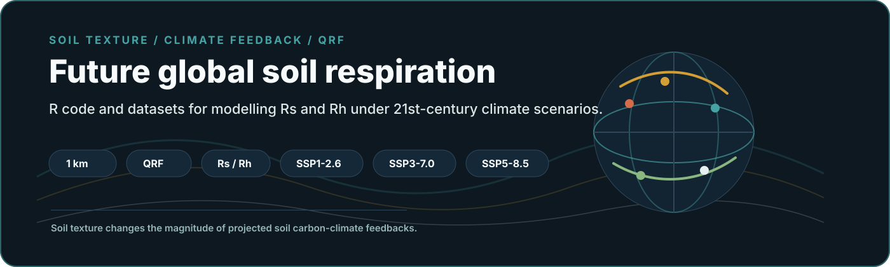
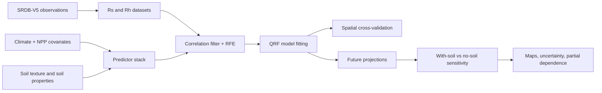
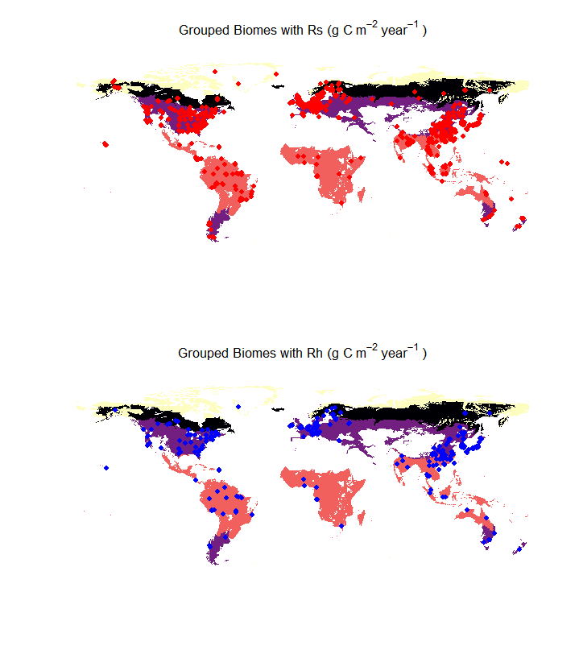

<p align="center">
  
</p>

<p align="center">
  
</p>

<h1 align="center">On the Importance of Soil Texture for Predicting<br>Future Global Soil Respiration</h1>

<p align="center">
  <strong>R scripts and datasets supporting global projections of total and heterotrophic soil respiration under 21st-century climate scenarios.</strong>
</p>

<p align="center">
  <a href="https://doi.org/10.1016/j.scitotenv.2026.181663"></a>
  <a href="https://doi.org/10.5281/zenodo.14991466"></a>
  
  
</p>

<p align="center">
  
  
  
  
  
</p>

<p align="center">
  <a href="#paper-first">Paper First</a> |
  <a href="#at-a-glance">At A Glance</a> |
  <a href="#workflow">Workflow</a> |
  <a href="#repository-map">Repository Map</a> |
  <a href="#datasets">Datasets</a> |
  <a href="#results">Results</a>
</p>

<table align="center">
  <tr>
    <td align="center"><strong>Canonical citation</strong></td>
  </tr>
  <tr>
    <td align="center">
      Gomes, L. C.; Moquedace, C. M.; Souza, I. F.; Bond-Lamberty, B.; Vargas, R.; Vesterdal, L.; Veloso, G. V.; Francelino, M. R.; Schaefer, C. E. G. R.; Morris, K. A.; Fernandes-Filho, E. I. (2026).<br>
      <em>On the importance of soil texture for predicting future global soil respiration</em>.<br>
      <strong>Science of the Total Environment</strong>, 1027, 181663. <a href="https://doi.org/10.1016/j.scitotenv.2026.181663">https://doi.org/10.1016/j.scitotenv.2026.181663</a>
    </td>
  </tr>
</table>

## Paper First

This repository supports the scientific article above. The article is the
canonical source for methods, results, and interpretation; this repository
organizes the code, tabular inputs, and links to final raster products.

The study tests how including or excluding soil texture-related variables
changes projections of total soil respiration (`Rs`) and heterotrophic
respiration (`Rh`) under climate change scenarios up to 2100.

## At A Glance

<table>
  <tr>
    <td width="25%"><strong>Question</strong><br>How does soil texture affect future global Rs and Rh projections?</td>
    <td width="25%"><strong>Data</strong><br>SRDB-V5 field observations plus climate, vegetation, and soil covariates.</td>
    <td width="25%"><strong>Model</strong><br>Quantile Regression Forest with uncertainty outputs.</td>
    <td width="25%"><strong>Scale</strong><br>Global 1 km predictions through 2100.</td>
  </tr>
  <tr>
    <td><strong>Targets</strong><br>Total soil respiration (`Rs`) and heterotrophic respiration (`Rh`).</td>
    <td><strong>Scenarios</strong><br>SSP1-2.6, SSP3-7.0, and SSP5-8.5.</td>
    <td><strong>Comparison</strong><br>With-soil versus no-soil covariate configurations.</td>
    <td><strong>Output</strong><br>Mean projections and uncertainty maps hosted on Zenodo.</td>
  </tr>
</table>

## Workflow



## Repository Map

```text
.
|-- datasets/                     # Model-ready Rs/Rh datasets
|-- img/                          # Institutional logos and figure previews
|-- pages/                        # Script walkthroughs and analysis notes
|-- CITATION.cff
`-- README.md
```

## Datasets

| Dataset | Description |
| --- | --- |
| [`finaldataset_rs_withsoil.csv`](datasets/finaldataset_rs_withsoil.csv) | Total soil respiration dataset including soil variables. |
| [`finaldataset_rh_withsoil.csv`](datasets/finaldataset_rh_withsoil.csv) | Heterotrophic respiration dataset including soil variables. |
| [`finaldataset_rs_nosoil.csv`](datasets/finaldataset_rs_nosoil.csv) | Total soil respiration dataset excluding soil variables. |
| [`finaldataset_rh_nosoil.csv`](datasets/finaldataset_rh_nosoil.csv) | Heterotrophic respiration dataset excluding soil variables. |

## Code Walkthroughs

| Page | Focus |
| --- | --- |
| [`distribution_samples.md`](pages/distribution_samples.md) | Distribution of samples across ecoregions and biome groups. |
| [`global_model_ckfold.md`](pages/global_model_ckfold.md) | Global model training with spatially restricted data division. |
| [`global_model_skfold.md`](pages/global_model_skfold.md) | Global model training without spatial restriction. |
| [`performance_model_ckfold.md`](pages/performance_model_ckfold.md) | Model performance with spatially restricted data division. |
| [`performance_model_skfold.md`](pages/performance_model_skfold.md) | Model performance without spatial restriction. |
| [`partial_dependecy.md`](pages/partial_dependecy.md) | Partial dependence analysis for Rs and Rh models. |

## Results

Final maps and uncertainty products are available on Zenodo:

| Resource | Link |
| --- | --- |
| Final maps | https://zenodo.org/records/14991466 |
| DOI | `10.5281/zenodo.14991466` |
| Products | Rs, Rh, and uncertainty projections for present and future scenarios. |

<p align="center">
  
</p>

## Citation

If you use this repository, cite the article above and the Zenodo record for
the final maps. Machine-readable citation metadata is available in
[`CITATION.cff`](CITATION.cff).

## Contact

For collaboration inquiries:

- lucas.gomes@agro.au.dk
- cassiomoquedace@gmail.com
- labgeo@ufv.br

The authors are not obligated to provide user support, updates, or bug fixes.
